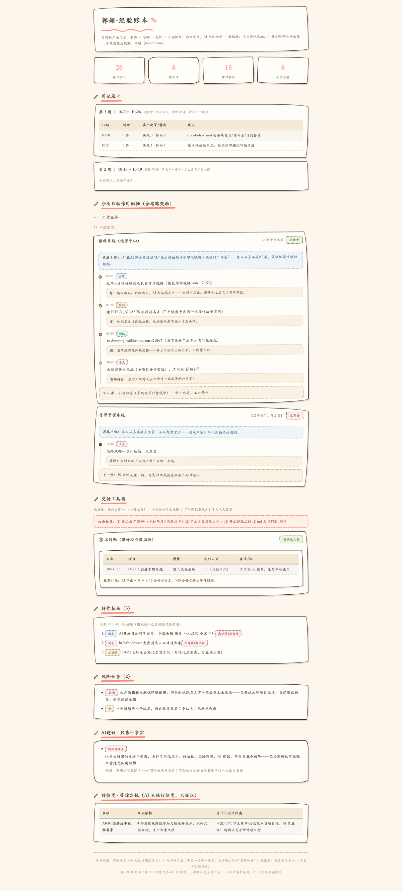
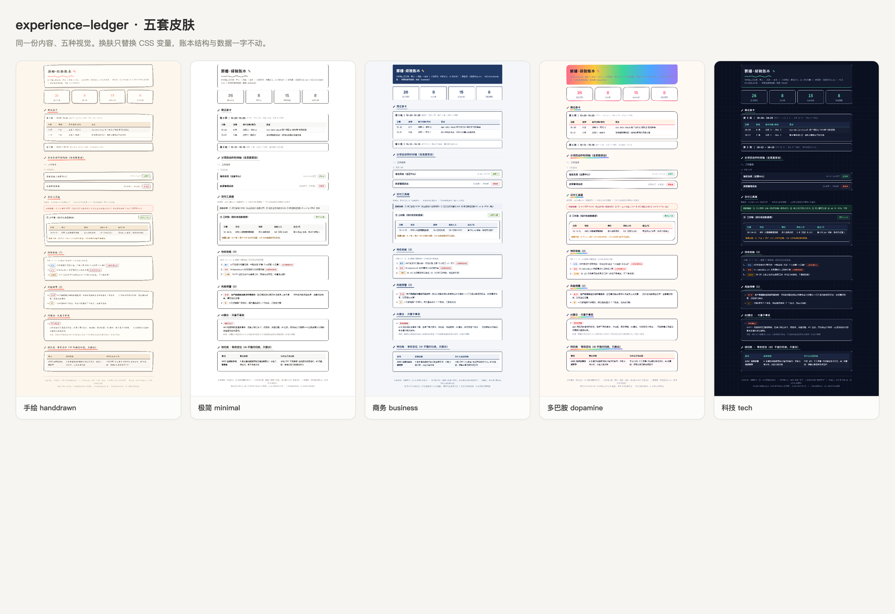

# experience-ledger · 经验账本

> An experience ledger that runs inside your AI agent — journals your work daily, turning chats and projects into traceable records of what happened, why you thought so, and what changed. AI helps you remember your own path instead of pushing you forward. **A mirror that doesn't flatter you.**

一个 Agent Skill。装上之后，它会扫描你的工作空间与对话记录，帮你生成一本可回溯的**经验账本**：分项目时间轴、能力卡片、工时账、可视化 HTML 账本。



<sub>▲ 这是账本的真实渲染截图（手绘皮肤），内容为示例数据。展开项目卡即可看到「事实 → 思路 → 变化」三层时间轴。</sub>

## 它解决什么问题

AI 让任务推进变快，人容易把「AI 产出很多」误当成「我成长了很多」。会话结束即蒸发，决策链路沉在聊天记录里。经验账本是一面**不讨好自己的镜子**——它记录的不只是「做了什么」，更是「当时为什么这么想、后来为什么变」。

**账本分三层，缺一层就退化成流水日记：**

| 层 | 内容 | 作用 |
|---|---|---|
| 记忆层 | 分项目时间轴（事实 / 思路 / 变化） | 回忆动作，检索决策链路 |
| 提炼层 | 能力卡片、思路主线、承诺-变化-原因-调整 | 把经历变成可复用规则 |
| 交付层（可选） | SOW、工时账、报价校准 | 让经验能对外定价 |

## 五套皮肤



<sub>▲ 五套皮肤同一份内容。内容结构与皮肤彻底分离——换肤只替换 CSS 变量，账本结构与数据一字不动。</sub>

| 皮肤 | 适用场景 |
|---|---|
| **手绘** handdrawn（默认） | 暖米色纸面、手绘边框、蜡笔点时间轴。适合个人长期使用与视频号展示 |
| **极简** minimal | 白底细线、系统字体。适合打印与职场阅读 |
| **商务** business | 深蓝主色、栅格感。适合对外汇报与客户演示 |
| **多巴胺** dopamine | 彩虹条 + 圆角胶囊。年轻态，适合传播 |
| **科技** tech | 深色底等宽字体。开发者审美 |

## 安装

**方式一：直接告诉你的 agent**

```
帮我装一下 experience-ledger 这个 skill
```

**方式二：手动**

把整个文件夹放进 agent 的skills 目录：

- WorkBuddy / Claude Code：`~/.claude/skills/experience-ledger/`（WorkBuddy 亦可用其内置 skill 搜索安装）
-项目级：`<项目>/.claude/skills/experience-ledger/`

**方式三：命令行（支持 Agent Skills 标准的 agent 通用）**

```bash
npx skills add <你的GitHub 账号>/experience-ledger
```

## 首次使用

装上后对 agent 说「建个经验账本」，它会走一次约5 分钟的**安装向导**：

1. 问你账本叫什么、怎么称呼你
2. 问你事情分成哪几类（**类目归你，agent 无权增删改**）
3. 问你扫描哪些路径（隐私边界，只读你允许的目录）
4. 问你出账频率与时间（agent 有定时能力时会建成自动化任务）
5. 让你选账本皮肤（六选一）
6. 问你是否需要交付层（SOW / 能力卡片 / 工时账）

向导结束后会做**冷启动回填**：扫描历史文件与对话，把账本先填满再交给你——这样你第一天打开就有内容看，而不是一个空壳。

## 账本结构（九个板块，固定顺序）

模板取自真实使用中的账本（而非通用骨架），类名与结构一一对应，**出账只改数据，不改板块、不改类名、不改顺序**：

| # | 板块 | 内容要点 |
|---|---|---|
| 1 | 头部 + 统计条 | 四个数字：登记项目／待补录／待你拍板／风险预警 |
| 2 | 周记录卡 | 每周一张，当周置于最上方且展开，历史收起；**每日出账往当周卡追加** |
| 3 | 分项目动作时间轴（含思路变动） | 按类目分组，每项目一张卡：思路主线 + 三层记录时间轴 + 下一步 |
| 4 | 交付工具箱 | 四条铁律 + SOW 模板／能力卡片库／工时账／报价公式／更新 SOP／待研究清单 |
| 5 | 待你拍板 | 编号列表，连续 3 期未动升级风险预警 |
| 6 | 风险预警 | 分级（高／中／低），写清触发条件 |
| 7 | AI建议 · 只基于事实 | 每条含问题动作 + 事实依据出处 |
| 8 | 待归类 · 等你定位 | 事项／事实依据／为什么无法归类；AI 只提议不擅建 |
| 9 | 页脚 | 分类归属、三层记录说明、数据源、出账声明 |

## 出账节奏：每日

**默认每日出账**，只处理过去 24 小时增量；周日额外补发全周汇总与上周对比。
无变动的项目卡不动——避免每天重写全部内容。

## 项目开工即记工时（自动触发）

只要一次对话属于以下任一情形，就视为项目开工，须立即登记：

- 新建/改造程序、网站、小程序、脚本、部署、上云
- 成体系的视觉/物料设计（海报、视频、IP 形象、画风体系）
- 调研后要落地成方案文档（报告、SOP、PPT）
- 一次对话跨越 3 轮以上且产生可交付物

**排除**：随口提问、概念解释、翻译查词、单文件小改、纯闲聊。

```bash
python3 scripts/open_project.py --dir <账本目录> --name "项目名" --category "所属类目" --module "模块名"
```

自动在 `项目登记表.md` 建项目行、在 `交付台账.md` 建工时账行。**为什么必须自动化**：铁律③「开工即记工时」之所以经常断档，是因为它依赖记性——把开工变成一条命令，账本里先有空行，才谈得上回填。结项时用 `calc_worktime.py` 核算人天。

## 五套皮肤

内容结构与皮肤分离，**换肤不改动任何数据**。

| 皮肤 | 气质 | 适合 |
|---|---|---|
| `handdrawn`手绘（默认） | 暖米色纸面、手绘不规则边框、珊瑚粉点缀、手写感字体 | 个人叙事、复盘记录 |
| `minimal` 极简 | 白底、细线、无装饰、系统字体 | 职场人士、打印阅读 |
| `business` 商务 | 深蓝主色、方正、栅格感 | 对外汇报、正式场合 |
| `dopamine` 多巴胺 | 多巴胺配色、圆角胶囊、彩虹条 | 年轻态社媒传播 |
| `tech` 科技 | 深色底、等宽字体、网格线 | 开发者、极客用户 |

换肤命令：

```bash
python3 scripts/new_ledger.py --dir <账本目录> --switch-skin minimal
```

## 五条防翻车铁律

这五条是这个 skill 与「效率打卡工具」的分界线，硬约束：

1. **本地化** —— 账本只存本地文件；发布公网必须显式开启、随时可撤；要求删除即删除不留副本
2. **不做 KPI** —— 禁止评分、排名、「本周成长几分」；账本是复盘材料不是考核表，它的读者只有账主本人
3. **标签需人工确认** —— AI会把犹豫解释成拖延、把探索解释成低效；判断性标签一律交你确认
4. **不设全局任务板** —— 行动出口挂在每张项目卡的「下一步」里；不额外造「本周必做一件事」，因为账本是镜子不是任务引擎
5. **区分主动取舍与被动失控** —— 推迟不等于失信；记录「承诺—变化—原因—调整」四元组，禁用「言而无信」「烂尾」这类审判语言

另有一条诚实规则贯穿始终：**思路必须来自真实对话或你的口述，还原不了就标「思路待补」，绝不编造。**

## 隐私边界

- 扫描范围由你定义，超出范围的路径 agent 一律不读
- 账本文件 100% 存于你自己的机器，不自动上传任何第三方服务
- 对话内容读取可单独关闭（关闭后仅记录你手动口述的内容）
- 发布到公网是**可选项**，默认关闭
- 要求删除时直接删除本地文件，不留副本（除非你明确要求备份）

## 工具脚本

```bash
# 开工登记（项目开工时第一条命令）
python3 scripts/open_project.py --dir <账本目录> --name "项目名" --category "类目" --module "模块"

# 扫描增量变动，生成候选入账清单（只读）
python3 scripts/scan_changes.py --root <工作空间> --since-hours 24

# 核算一段对话的「活跃交互工时」（等待与空档不计）
python3 scripts/calc_worktime.py <对话记录.jsonl>

# 建账本 / 换肤
python3 scripts/new_ledger.py --dir <账本目录> --title "我的经验账本" --skin handdrawn
```

工时口径：AI 产出时长（单轮封顶 60 分钟）+ 你 15 分钟内的回复计入活跃，超过 30 分钟的空档整体剔除为等待。

## 宿主差异

方法论（三层记录、能力卡片、诚实规则、工时核算）与宿主无关。**自动定时出账依赖宿主能力**：

- WorkBuddy / Claude Code 等具备定时任务与文件系统访问的环境 → 可全自动出账
- 纯网页对话环境 → 只能在你说「出账」时手动出账（不会自动运行，README 不做虚假承诺）

## 目录结构

```
experience-ledger/
├── SKILL.md                      主指令：铁律、流程、边界
├── references/
│   ├── 安装向导与冷启动.md        首次启用的完整流程
│   ├── 日常出账流程.md            八步出账 SOP
│   ├── 三层记录与标签规范.md      记录格式与标签词典
│   └── 防翻车五条.md             五条铁律的可执行细则
├── scripts/
│   ├── new_ledger.py             建账本（九板块）/ 换肤
│   ├── open_project.py           开工登记：建项目行 + 工时账行
│   ├── scan_changes.py           扫描增量变动
│   └── calc_worktime.py          活跃交互工时核算
├── assets/skins/                 base.css 结构层 + 5 套主题
├── docs/                         README 首屏图（真实渲染截图）
└── LICENSE                       MIT
```

## 账本里有什么

九 个板块，缺一个就退化成流水账：

1. **周记录卡** —— 当周每日增量汇总，历史周卡收起可点开
2. **分项目动作时间轴** —— 每条记录三层：事实（做了什么）→ 思路（当时怎么想、依据什么判断）→ 变化（什么触发了转向）
3. **交付工具箱** —— SOW 模板、能力卡片库、工时账、报价公式、更新发布 SOP
4. **待你拍板** —— 需要你决策的事，挂了 3 期自动升级进风险预警
5. **风险预警** —— 连续多期未动的事，不再沉默
6. **AI 建议 · 只基于事实** —— 每条建议必须给事实依据，严禁捧杀、严禁无依据表扬
7. **待归类** —— 归不进现有类目的，AI 只提议、绝不擅自归类

> 一条典型记录长这样：
> **事实**：催收系统把 Word 模板解剖成机器可读规格（模板结构规格.json，76KB）
> **思路**：模板固定、数据固定，AI 却总填不对——说明它在猜。规格化之后它才有的可依
> **变化**：建 FIELD_ALIASES 字段别名表（7 个楼盘子表同一字段叫法全不同）

## 授权协议

MIT——最宽松的开源协议：任何人可以自由使用、修改、商用、再分发，只需保留版权声明。详见 [LICENSE](LICENSE)。

## 一点提醒

这个 skill 会让你看到自己「说过但没做」的事。这是它的价值，也是它可能让你不舒服的地方。如果某期实在不想记，账本允许空账——**它不需要看起来很勤奋**。
